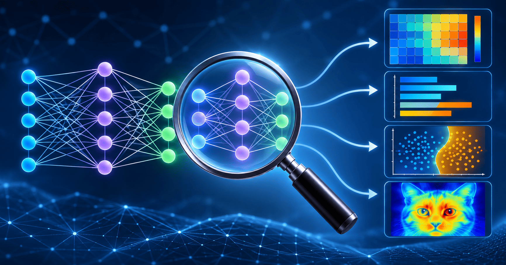

NNs Might Be Interpretable After All
====================================

*Date: June 7, 2026*

Two recent blog posts (ironically) seem to suggest that neural networks (NNs) are interpretable. The notion that they are black-box, mysterious objects is likely mistaken.

In this blog post, I quickly comment on `Nick Cammarata's Neural Networks Are Already Clean <https://already-clean.goodfire.com/#cars-and-animals>`__ and `Rikiya Takehi's LLMs can natively read & write neural network weights <https://rikiyat.github.io/blog/weight-space-programming/>`__.

Neural Networks Are Already Clean
---------------------------------
In summary, Nick Cammarata claims that NNs are not a collection of neurons whose semantic roles are jumbled, as was previously widely held.
Instead, the neurons in an NN have defined, easily interpretable roles.
Interestingly, this discovery became possible by investigating larger NNs. 

"The bad news about modern neural networks is that they're enormous. The good news is that the enormity helps: as the map fills in, every explanation is tightly constrained by everything around it, and bigger models learn narrower neurons that are easier to recognize in the first place."

Smaller NNs "run out of neurons" so that the features that each neuron learns somehow overlap with the neighbouring neurons.
As such, this phenomenon was mistakenly interpreted as superposition.
Mechanistic interpretation as a field has gravitated to increasingly complicated procedures to untangle the features from their supposed superposition.
These untangling procedures are therefore unnecessary and misleading according to Nick.

Yet again, this cautions us that what is widely accepted might actually not be true. NNs are not "mysteriously black-box"; they are actually quite interpretable.

"In that sense, almost the entire network is interpretable if we look closely enough, especially if we look at how it grew over training."

LLMs Can Natively Read & Write Neural Network Weights
-----------------------------------------------------

Rikiya Takehi's post is at once the more exciting and frightening one.
The bold claim is that LLMs can directly modify the weights of an NN.
In other words, LLMs can do weight space programming.
This is revolutionary.

Whilst human scientists see a meaningless sea of numbers in NNs, LLMs can easily interpret what the weights are doing. As a result, Rikiya et al. find that an LLM can determine what task an NN was trained to solve just by "looking" at the weights. 
It can repair an NN so that it is able to complete a task it was previously failing at.
It can even create an NN from scratch.

What is it revolutionary? Up to now, human scientists have relied on expensive dataset curation and NN training procedures.
Weight space programming is now an alternative.
We don't need to carry out mathematical optimisation via gradient descent, an operation that is likely slower and more expensive than weight space programming.

Rikiya et al. identify a few opportunities that may be created:

- Auditing: LLMs can be used to investigate other NNs. No surprise, Nick Cammarata already dabbles in this.

- Cheaper solutions: expensive optimisation will be unnecessary once there is an LLM.

- No datasets needed: LLMs do not need a dataset to create or modify NNs.

- Unlearning: allows, for instance, removing so-and-so's data from an NN. Unlearning is becoming increasingly useful for data privacy and protection.

- Self-improvement: agents will much more easily improve themselves (scary).

- Two NNs excelling at different tasks can be meaningfully combined (model merging).

